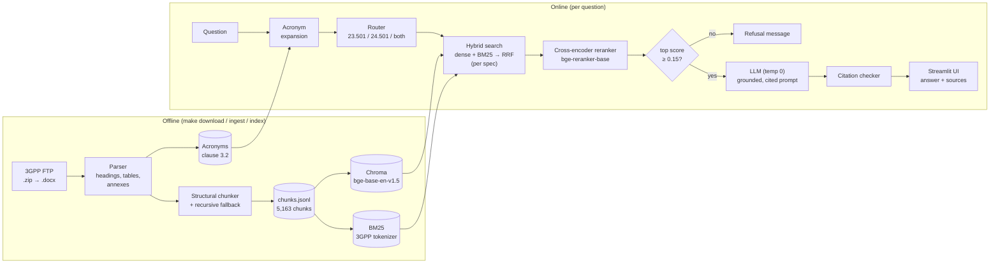
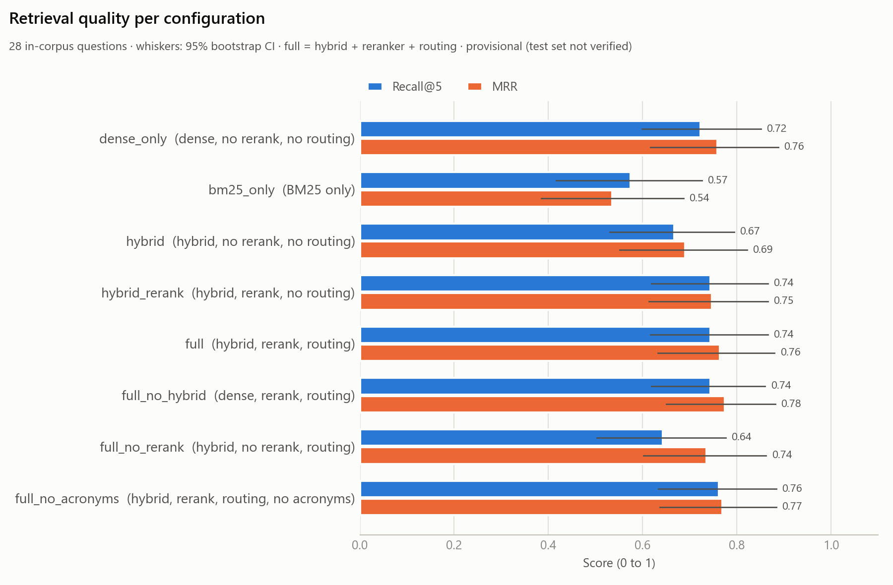
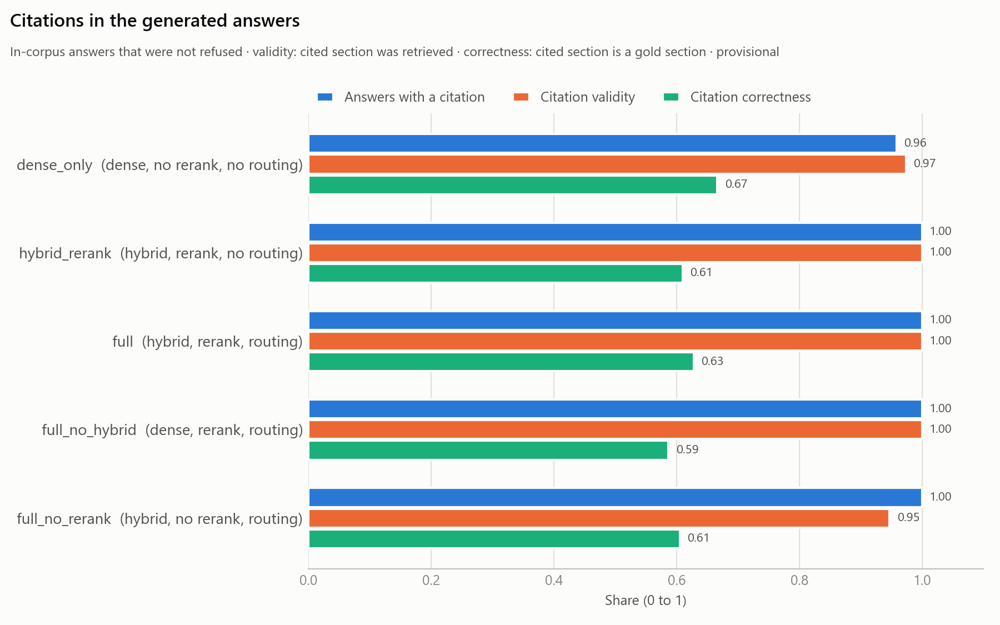
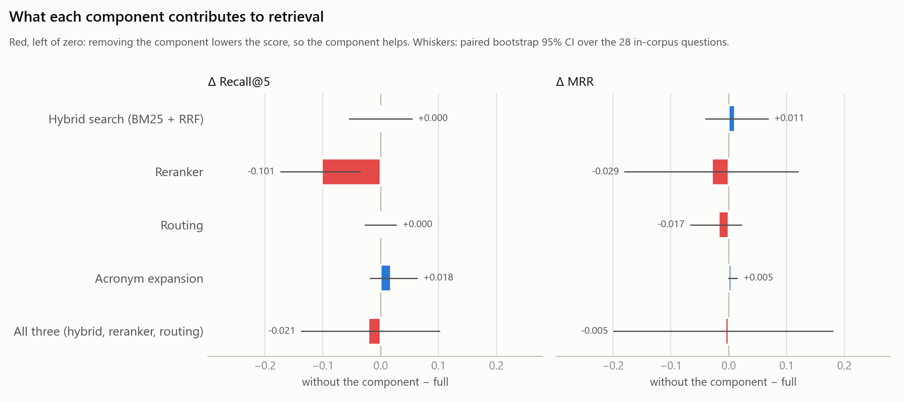

# 5G RAG Chatbot: 3GPP TS 23.501 & TS 24.501 (Release 18)

Retrieval-Augmented Generation (RAG) chatbot that answers questions **in English** about 5G
architecture, procedures, NAS messages and mechanisms, grounded **exclusively** in two 3GPP
Release 18 specifications:

- **TS 23.501 V18.12.0**: System architecture for the 5G System (Stage 2)
- **TS 24.501 V18.14.0**: Non-Access-Stratum (NAS) protocol for 5GS (Stage 3)

Every factual statement cites spec and section, e.g. `(TS 24.501, §5.5.1.2.2)`. When the
information is not in the corpus, the answer is exactly:
`I could not find this information in the documents.`

> Mini-projet de contrôle continu, Futurs Réseaux Mobiles (RT5, INSAT 2026/2027).

**Contents:**
[Architecture](#architecture) ·
[Corpus](#corpus) ·
[Installation](#installation) ·
[Execution](#execution) ·
[Configuration](#configuration) ·
[Method](#method) ·
[Evaluation](#evaluation) ·
[Results](#results) ·
[Error analysis](#error-analysis) ·
[Limitations](#limitations) ·
[Perspectives](#perspectives) ·
[Project structure](#project-structure)

---

## Architecture



| Stage | Implementation |
|---|---|
| Ingestion | `src/ingest/download.py`, `parse_docx.py`, `chunker.py` |
| Indexing | `src/index/embed.py`, `vector_store.py` (Chroma), `bm25_index.py` |
| Retrieval | `src/retrieve/acronyms.py`, `router.py`, `hybrid.py` (RRF), `reranker.py`, `pipeline.py` (entry point) |
| Generation | `src/generate/prompt.py`, `llm.py` (Groq / Gemini / OpenAI / Ollama), `citation_check.py`, `answer.py` (entry point) |
| Interface | `src/app/streamlit_app.py` |
| Evaluation | `eval/run_retrieval_eval.py`, `eval/run_generation_eval.py`, `eval/make_tables.py` |

## Corpus

The exact versions, download URLs, SHA256 checksums and the reasons for choosing these two
specifications and the .docx format are in [CORPUS.md](CORPUS.md). `make download` fetches the
archives from the 3GPP FTP server, checks them and regenerates the table in `CORPUS.md`. If the
server cannot be reached, it prints the URLs to download manually.

## Installation

Requirements: **Python 3.11** and GNU `make` (on Windows: e.g. `choco install make`, or run the
commands of the [table below](#execution) directly). A GPU is optional; everything runs on CPU.
The embedding and reranker models are downloaded from Hugging Face on first use.

```bash
git clone https://github.com/yesmineChaari/5G-Standards-Assistant.git
cd 5G-Standards-Assistant
make install            # creates .venv (Python 3.11) and installs the pinned requirements.txt
cp .env.example .env    # then add your API key(s), see below
```

Without `make`: `py -3.11 -m venv .venv` (Linux/macOS: `python3.11 -m venv .venv`), then
`.venv\Scripts\python -m pip install -r requirements.txt` (Linux/macOS: `.venv/bin/python ...`).

**API keys (`.env`)**, all optional for the evaluation (see [Reproducibility](#reproducibility)):

| Variable | Used for | Where to get it |
|---|---|---|
| `GROQ_API_KEY` | Answer generation (default: `openai/gpt-oss-120b`) and routing ties | console.groq.com (free tier) |
| `GOOGLE_API_KEY` | RAGAS judge (`gemini-3.1-flash-lite`); Gemini as generator in the app | aistudio.google.com (free tier) |
| `OPENAI_API_KEY` | Optional generator | platform.openai.com |

**Local models (optional, Ollama):** install [Ollama](https://ollama.com), run `ollama pull llama3.1:8b`,
then choose *ollama (local)* in the app sidebar or set `llm.provider: "ollama"` and `llm.model` in
`config.yaml`. `OLLAMA_HOST` in `.env` changes the server address (default `http://localhost:11434`).

## Execution

| Target | What it does | Command without `make` |
|---|---|---|
| `make install` | Create `.venv` and install pinned dependencies | see [Installation](#installation) |
| `make download` | Download and unzip the two specs, SHA256, update `CORPUS.md` | `python -m src.ingest.download` |
| `make ingest` | Parse + chunk → `data/processed/chunks.jsonl`, chunk statistics, acronym dictionary | `python -m src.ingest.chunker`, `python scripts/inspect_chunks.py`, `python -m src.retrieve.acronyms build` |
| `make index` | Embeddings → Chroma; BM25 index | `python -m src.index.vector_store build`, `python -m src.index.bm25_index build` |
| `make app` | Streamlit demo on http://localhost:8501 | `python -m streamlit run src/app/streamlit_app.py` |
| `make test` | Unit tests (pytest) | `python -m pytest -q tests` |
| `make eval-retrieval` | Retrieval metrics, 8 configurations, routing accuracy | `python -m eval.run_retrieval_eval` |
| `make eval-generation` | Generation metrics (refusals, citations, RAGAS), 5 configurations | `python -m eval.run_generation_eval` |
| `make tables` | Ablation summary and charts | `python -m eval.make_tables` |
| `make eval` | `eval-retrieval` + `eval-generation` + `tables` | |
| `make all` | `download` → `ingest` → `index` → `test` → `eval` | |

(`python` = `.venv\Scripts\python` on Windows, `.venv/bin/python` elsewhere.)

Quick start after `make install`: `make all` (or `make download ingest index`), then `make app`.
Measured on a laptop CPU (no GPU): `make install` 9 min, `make download` + `make ingest` 3 min,
`make index` 30 min (embedding 5,163 chunks), `make test` 25 s. In `make eval`, each reranked
configuration takes about 7 min (cross-encoder on 30 candidates per question), so the whole
evaluation takes roughly one to one and a half hours.

**Other command-line tools:**

```bash
python -m src.generate.answer "What does cause #9 mean in 5GMM?"      # one answer, with citation check
python -m src.retrieve.pipeline "What is the role of the NRF?"         # dense vs hybrid vs reranked, side by side
python -m src.retrieve.router "Which NAS messages are used for registration?"
python scripts/find_sections.py search "T3510"                         # locate sections (test-set building)
```

### Demo app

`make app` opens a chat interface. Each answer shows:

- the answer with its citations, and a warning if a citation is not among the retrieved passages;
- the routing decision and its reason (e.g. `Routed to: TS 24.501 (keywords: 5GMM, cause #)`);
- the retrieved passages (spec, section, title, reranker score, text) in expandable *Sources*;
- a banner when the system refuses.

The sidebar switches hybrid search, reranker, routing and acronym expansion on and off, filters by
spec, sets the number of passages given to the LLM, and selects the provider and model. Without an
LLM (no key, Ollama not running) the app still shows the retrieved passages.

### Reproducibility

- Pinned dependencies (`requirements.txt`), fixed seed (42), temperature 0, exact (not
  approximate) vector search, so retrieval is deterministic.
- Indexes are fingerprinted (SHA256 of `chunks.jsonl` + settings) and rebuilt only when needed.
- **Recorded LLM calls.** API models are not guaranteed to be deterministic and free tiers have
  daily quotas, so every LLM call made by the evaluation is recorded in
  `eval/cache/generation/llm_calls.jsonl` and every RAGAS score in `eval/cache/ragas.jsonl`. Both
  files are versioned. `make eval` recomputes chunks, indexes, retrieval and prompts. A call is
  answered from the recording only if its prompt is byte-identical to a recorded one, otherwise
  the provider is called (API key needed). The full evaluation therefore runs **without any API
  key**, and a complete replay also shows that chunking, indexing and retrieval reproduce exactly.
- To recompute everything with the APIs, delete the `eval/cache/` folder. On free tiers this takes
  several days of quota (Groq's daily token limit for the generator, Gemini's daily request limit
  for the judge). A run stopped by a quota writes partial results, exits with code 3
  and resumes from the cache when run again.
- **Check:** a fresh clone followed by `make install` and `make all` with an empty `.env`
  (no API keys) succeeds: see [Reproducibility check](#reproducibility-check).

## Configuration

All parameters are in [`config.yaml`](config.yaml); modules contain no hard-coded paths or
model names.

| Section | Main settings |
|---|---|
| `corpus.specs` | Spec id, version, release, 3GPP URL and archive name. Adding a spec here is enough for download, ingestion and indexing. |
| `paths` | Raw, processed and results folders |
| `chunking` | `max_tokens: 450`, `overlap_tokens: 60`, `min_tokens: 40`, `max_table_tokens: 480`, measured with the embedding model's tokenizer; hard cap `max_index_tokens: 512` |
| `embeddings` | `BAAI/bge-base-en-v1.5`, query instruction, normalisation, device |
| `vector_store` | Chroma path, cosine distance, `exact_search: true` |
| `bm25` | `k1: 1.5`, `b: 0.75`, light plural stemming |
| `retrieval` | `dense_k`/`bm25_k: 30`, `rrf_k: 60`, `rerank_candidates: 30`, `final_k: 6`, and the switches `use_hybrid`, `use_reranker`, `use_routing`, `use_acronym_expansion` |
| `reranker` | `BAAI/bge-reranker-v2-m3` on GPU, `BAAI/bge-reranker-base` on CPU; `refusal_threshold: 0.15` |
| `llm` | Provider (`groq`, `gemini`, `openai`, `ollama`), model, temperature 0, token budgets, `reasoning_effort`, retries |
| `refusal_message` | The exact refusal sentence |
| `evaluation` | RAGAS judge provider/model, judges to compare, configurations evaluated |

## Method

### Parsing

The specs are parsed from the official .docx: the document body is walked in order (paragraphs
and tables). Headings are recognised by their paragraph style (`Heading 1..9`, 3GPP `H1..H9`).
The section number and title come from the heading text, and the level from the number
(`5.5.1.2` → 4, annex `A.1` → 2). Tables are converted to Markdown, keeping their rows and
header. The cover, table of contents, foreword, references clause and change history are skipped.
Figures are images and are lost; their captions are kept.

### Chunking: structural, with a recursive fallback

- **One chunk per section** (content between a heading and the next heading), so each chunk has
  exactly one citable section number.
- **Long text** (> 450 tokens) is split at paragraph boundaries with 60 tokens of overlap; an
  over-long paragraph is split at sentence boundaries.
- **Tables** are never split inside a row. A table up to 480 tokens is one chunk; larger tables are
  split into row groups that repeat the header row and caption. A short sentence that introduces a
  table is folded into it.
- **Very short sections** (< 40 tokens, e.g. "void" clauses or one-line definitions) are merged
  with the following sibling section(s); the chunk lists every merged number in `merged_sections`
  so that each of them remains citable.
- Each chunk carries `spec`, `release`, `section`, `title`, `type` (text/table) and
  `merged_sections`. The indexed text starts with a header line
  `[TS 24.501 | Rel-18 | §5.5.1.2.2 | Initial registration initiation]`, so spec, section and title
  are searchable and visible to the LLM.

Result: 5,163 chunks (TS 23.501: 1,816; TS 24.501: 3,347), median 356 tokens, 851 table chunks
([`chunk_stats.md`](eval/results/chunk_stats.md), samples in
[`chunk_samples.md`](eval/results/chunk_samples.md)). No chunk exceeds the embedding window
(512 tokens), so nothing is truncated.

### Indexing and retrieval

- **Dense:** `BAAI/bge-base-en-v1.5` embeddings (English, 768 dimensions) stored in Chroma; exact
  cosine search over all vectors.
- **Lexical:** BM25 with a tokenizer that keeps 3GPP identifiers whole (`T3510`, `#9`, `5GMM`,
  `S-NSSAI`, `9.11.3.2`, `5GMM-REGISTERED.NORMAL-SERVICE`). It normalises cause references
  (`cause 9`, `cause value #9` → `#9`) and also indexes the parts of hyphenated compounds.
- **Hybrid:** dense and BM25 top-30 lists fused with Reciprocal Rank Fusion (`k = 60`). When a
  question is routed to both specs, each spec is retrieved and fused separately and the lists are
  interleaved, so one spec cannot crowd out the other.
- **Reranking:** the 30 fused candidates are scored by a cross-encoder (`bge-reranker-base` on CPU,
  sigmoid score in [0, 1]); the top 6 go to the LLM.
- **Routing:** weighted keyword/regex signals per spec, chosen from term counts in the corpus.
  Examples: 5GMM states, cause values, IEs and NAS message names → 24.501; NF roles, reference
  points, RM/CM states, 5QI, SSC modes → 23.501. Cross-spec cues such as "both" or
  "architecture … NAS messages" send the question to both specs. A spec named explicitly decides.
  Questions without any signal are classified by the LLM; if it fails, both specs are searched.
  Errors are biased towards "both": a missed spec loses recall that the reranker cannot recover,
  while an extra spec only costs precision.
- **Acronym expansion:** a dictionary of 317 acronyms extracted from clause 3.2 of both specs;
  `NRF` in a question adds `(NRF: Network Repository Function)` to the dense and BM25 queries.

### Generation, refusal and citations

- **Prompt** (`src/generate/prompt.py`): answer only in English and only from the numbered
  context passages. Cite `(TS xx.xxx, §x.x.x)` after every factual statement, using only labels
  present in the passage headers. Never guess values, timers, causes, messages or IEs. Reply with
  the exact refusal sentence when the context does not contain the answer. When only part of the
  question is answered, say which part is missing. Temperature 0.
- **Refusal, layer 1:** if the best reranker score is below 0.15, the system refuses without
  calling the LLM. The threshold was chosen from the top reranker scores of 8 example questions:
  in-corpus questions scored 0.40 to 1.00, two clearly unrelated questions 0.04 and 0.06. These
  two are also out-of-corpus questions of the test set, so layer 1 was tuned on test items. A
  near-domain question (Wi-Fi 7 multi-link, 0.98, close to multi-path content) passes layer 1 and
  must be refused by layer 2.
- **Refusal, layer 2:** the prompt rule; any variant of the refusal written by the LLM (quotes,
  bold, missing period) is normalised to the exact sentence.
- **Citation checker:** citations are extracted in all forms the model writes
  (`§§…`, `;`-separated specs, `3GPP TS …`, bracket marks). Each (spec, section) must be the
  section of a retrieved chunk or one of its `merged_sections`; invalid citations are reported in
  the UI and in the evaluation, never silently removed.

## Evaluation

### Test set

[`eval/testset.yaml`](eval/testset.yaml) contains 31 questions: 10 simple questions on TS 23.501,
10 on TS 24.501, 8 cross-spec questions and 3 out-of-corpus questions. Each question has a
reference answer, gold section(s) and an expected spec. The out-of-corpus questions (NR band
n78 frequencies, Wi-Fi 7 multi-link operation, LTE-M modulation) come with terms that were checked to be
absent from the corpus. Gold sections were located with `scripts/find_sections.py`
(full-text search in the parsed specs); `scripts/find_sections.py check` verifies that every gold
section exists.

> **Status:** every entry still has `verified: false`, so all results below are **provisional**
> until each gold section and reference answer has been checked by a person. Every report
> repeats this warning.

### Section matching rule

A retrieved chunk is **relevant** to a gold section if it has the same spec and its `section`
(or one of its `merged_sections`) **equals the gold section or is a sub-section of it**:
`5.5.1.2.2` matches gold `5.5.1.2`, but `5.5.1` does not. The same rule decides whether a
citation is correct.

### Metrics

| Level | Metric | Definition |
|---|---|---|
| Retrieval | Recall@k (k = 1, 3, 5, 10) | Share of a question's gold sections found in the top k, averaged over questions |
| | Hit@k | At least one gold section in the top k |
| | MRR | Mean of 1 / rank of the first relevant chunk (0 if not in the top 10) |
| | Both specs@k, both relevant@k | Cross-spec only: both specs present / a relevant chunk from each spec in the top k |
| | Routing accuracy | Router output vs expected spec (exact, covers) |
| Generation | Refusal accuracy | Out-of-corpus questions answered with the exact refusal sentence |
| | False refusals | In-corpus questions refused |
| | With citation, citation validity, citation correctness | Answers with ≥ 1 citation; cited sections present in the retrieved context; cited sections matching a gold section |
| | Faithfulness (RAGAS) | Share of the answer's claims supported by the retrieved passages |
| | Answer correctness (RAGAS) | Agreement with the reference answer (factual F1 + semantic similarity); a wrong refusal scores 0 |

**Statistics.** With 28 in-corpus questions, one question changes Hit@k by 0.036. All tables
therefore give 95% bootstrap confidence intervals (2,000 resamples over questions). Ablation
deltas use a **paired** bootstrap (same questions, both configurations); a difference is called
significant only when its interval excludes 0.

**RAGAS judge.** The judge is `gemini-3.1-flash-lite`, from a different model family than the
generator (`gpt-oss-120b`), to limit self-preference bias. Scores from an earlier judge of the
generator's family (`gpt-oss-20b`) on the same answers are kept for comparison.

**Configurations.** Retrieval: `dense_only`, `bm25_only`, `hybrid`, `hybrid_rerank` (no routing),
`full` (hybrid + reranker + routing + acronyms), `full_no_hybrid`, `full_no_rerank`,
`full_no_acronyms`. Generation: `full`, `hybrid_rerank`, `full_no_hybrid`, `full_no_rerank`,
`dense_only`. RAGAS (≈ 8k judge tokens per answer) runs on `full` only because of free-tier
quotas.

## Results

Full reports: [`retrieval_results.md`](eval/results/retrieval_results.md),
[`routing_results.md`](eval/results/routing_results.md),
[`generation_results.md`](eval/results/generation_results.md),
[`ablation_summary.md`](eval/results/ablation_summary.md); per-question data in
`retrieval_raw.jsonl` and `generation_raw.jsonl`. *Provisional: test set not yet verified.*

### Retrieval (28 in-corpus questions)

| Config | Components | R@5 | R@5 95% CI | R@10 | Hit@5 | MRR | Cross-spec both relevant@5 |
|---|---|---|---|---|---|---|---|
| `bm25_only` | BM25 only | 0.574 | 0.42–0.73 | 0.610 | 0.714 | 0.536 | 0.250 |
| `dense_only` | dense | 0.723 | 0.60–0.85 | 0.786 | 0.929 | 0.759 | 0.375 |
| `hybrid` | dense + BM25 (RRF) | 0.667 | 0.53–0.79 | 0.795 | 0.857 | 0.691 | 0.375 |
| `hybrid_rerank` | + reranker | 0.744 | 0.62–0.87 | 0.774 | 0.929 | 0.747 | 0.250 |
| **`full`** | + routing, acronyms | **0.744** | 0.62–0.87 | 0.795 | 0.929 | 0.764 | 0.375 |
| `full_no_hybrid` | full without BM25 | 0.744 | 0.62–0.86 | 0.753 | 0.929 | 0.775 | 0.375 |
| `full_no_rerank` | full without reranker | 0.643 | 0.50–0.78 | 0.750 | 0.857 | 0.735 | 0.125 |
| `full_no_acronyms` | full without acronyms | 0.762 | 0.63–0.88 | 0.795 | 0.929 | 0.769 | 0.250 |

By question type (`full`, R@5): TS 23.501 1.00, TS 24.501 0.80, cross-spec 0.35. Routing
accuracy (exact): 1.00 on simple questions, 0.625 on cross-spec questions (3 of 8 routed to a
single spec).



### Generation (31 questions)

| Config | Refusal acc. (OOC) | False refusals | With citation | Citation validity | Citation correctness | Faithfulness | Answer correctness |
|---|---|---|---|---|---|---|---|
| **`full`** | 1.00 | 0.11 | 0.84 | 1.00 | 0.67 | 0.92 (n=25) | 0.56 (n=28) |
| `hybrid_rerank` | 1.00 | 0.11 | 0.96 | 1.00 | 0.62 | - | - |
| `full_no_hybrid` | 1.00 | 0.07 | 0.85 | 1.00 | 0.62 | - | - |
| `full_no_rerank` | 1.00 | 0.04 | 0.93 | 0.94 | 0.62 | - | - |
| `dense_only` | 1.00 | 0.14 | 0.88 | 0.97 | 0.69 | - | - |

- All 3 out-of-corpus questions are refused with the exact sentence, in every configuration:
  by the threshold (layer 1) for n78 and LTE-M in most reranked configurations, by the LLM
  (layer 2) otherwise. All 13 false refusals over the five configurations come from layer 2; the
  threshold never refused an in-corpus question.
- **No invented section** in the reranked configurations: every citation points to a retrieved
  passage (validity 1.00). Without the reranker, 3 to 6% of citations point outside the context.
- `full` by type: faithfulness 0.95 / 0.92 / 0.88 and answer correctness 0.63 / 0.56 / 0.48 for
  TS 23.501 / TS 24.501 / cross-spec questions. Only 3 of the 7 answered cross-spec questions
  contain a citation in the required format, the weakest point of the system (see
  [Error analysis](#error-analysis), case 4).
- **Judge comparison** (25 shared answers): the same-family judge `gpt-oss-20b` scores
  faithfulness +0.01 and answer correctness +0.03 higher than the Gemini judge (Pearson r 0.68 and
  0.83). This is no sign of a large self-preference effect.



### Ablations (paired 95% CI; `*` = significant)

| Component removed | Δ Recall@5 | Δ MRR | Δ Both specs@5 (cross-spec) | Δ False refusals |
|---|---|---|---|---|
| Hybrid search (BM25 + RRF) | +0.000 [-0.05, +0.05] | +0.011 [-0.04, +0.07] | +0.000 | -0.036 [-0.14, +0.07] |
| **Reranker** | **-0.101 [-0.17, -0.04] \*** | -0.029 [-0.18, +0.12] | +0.000 | -0.071 [-0.18, +0.00] |
| Routing | +0.000 [-0.03, +0.03] | -0.017 [-0.07, +0.02] | +0.250 [-0.25, +0.62] | +0.000 |
| Acronym expansion | +0.018 [-0.02, +0.06] | +0.005 [+0.00, +0.01] | +0.000 | - |
| All three (→ `dense_only`) | -0.021 [-0.14, +0.10] | -0.005 [-0.20, +0.18] | +0.375 [+0.12, +0.75] \* | +0.036 [-0.14, +0.21] |



**Reading.**
- The **reranker** is the only component with a significant effect on recall (+0.10 R@5).
  Without it, false refusals drop from 0.11 to 0.04 (not significant). These refusals are LLM
  decisions on different contexts, not threshold refusals (case 2 below).
- **Hybrid search** brings no measurable gain on this test set: dense retrieval alone reaches the
  same recall, and BM25 alone is the weakest configuration.
- **Routing** does not change recall on simple questions. On cross-spec questions it reduces
  coverage: 3 of 8 were routed to a single spec, and without routing both specs appear in the
  top 5 more often (+0.25, not significant).
- **Acronym expansion** has no measurable effect.
- With 28 questions (8 cross-spec), effects smaller than about 0.05 to 0.10 cannot be detected.

### Reproducibility check

A fresh clone of the repository, followed by `make install` and `make all` with an empty `.env`
(no API keys), on 2026-11-23:

| Step | Result |
|---|---|
| `make install` | ok: new `.venv`, pinned requirements |
| `make download` | ok: both archives downloaded from 3GPP, SHA256 identical to `CORPUS.md` (only the download date changes) |
| `make ingest` | `chunks.jsonl`, `acronyms.json`, `chunk_stats.md` and `chunk_samples.md` byte-identical to the versioned files |
| `make index` | ok: 5,163 chunks in Chroma and BM25 |
| `make test` | 189 passed |
| `make eval-retrieval` | 5 of 8 configurations completed (`dense_only`, `bm25_only`, `hybrid`, `hybrid_rerank`, `full`): for all 28 in-corpus questions, identical ranked sections, routing decisions (LLM routing ties replayed from the recording without a key) and scores |

The run was then stopped by the operating system for lack of memory (the machine was running
other applications), during the sixth retrieval configuration. The generation evaluation was
therefore not replayed in the fresh clone; that part of the check remains to be run
(`make eval` in the clone resumes from the retrieval results already computed).

## Error analysis

Failure cases of the `full` configuration (`generation_raw.jsonl`):

1. **Information only in a figure: S24-04** *"What are the main 5GMM states of the UE?"* The
   overview of the states is a state diagram (Figure 5.1.3.2.1.1.1), lost in parsing. Each main
   state is its own short sub-section (§5.1.3.2.1.2.1 to §5.1.3.2.1.2.6), so no chunk lists them
   together. The retrieved context contains the "General" clause that points to the figure and a
   few individual states, and the LLM refuses (false refusal).
2. **The reranker prefers a table over the defining sentence: S24-09** *"Which identities can the
   5GS mobile identity IE carry?"* The answer is the first paragraph of §9.11.3.4 ("…to provide
   either the SUCI, the 5G-GUTI, the IMEI, …"). In `full`, the reranker keeps two parts of the
   coding table of that section (ranks 4 and 5) instead of that paragraph, and the LLM refuses.
   `full_no_hybrid`, `full_no_rerank` and `dense_only` retrieve the paragraph and answer
   correctly.
3. **Retrieval miss on a cross-spec question: X-01** *"What does initial registration achieve in
   the 5G System architecture, and which NAS messages does the UE exchange with the AMF?"* None of
   the gold sections (23.501 §5.3.2.1, 24.501 §5.5.1.2.2 / §5.5.1.2.4) is retrieved. The context
   holds connection management (23.501 §5.3.3.1), slice selection at registration (§5.15.5.2.1)
   and NAS security establishment (24.501 §4.4.2.5), all of which match "registration" and "NAS".
   The LLM refuses, in every configuration.
4. **Citation format on cross-spec answers: X-04, X-08, X-03, X-05.** These answers are correct
   in substance but cite passage numbers (`[1]`), a section without its spec (`[§5.3.6, …]`) or no
   section at all. The checker counts only `(TS xx.xxx, §x.x)` citations, so these answers count
   as "without citation". With two specs in the context, the model loses the required format more
   often (3 of 7 answered cross-spec questions are correctly cited, vs 18 of 18 answered simple questions).
   A fix would be to map `[n]` passage references to the n-th passage's (spec, section) after
   generation.

## Limitations

- **Figures and diagrams are lost** in parsing (state machines, message sequence charts); only
  captions remain (case 1 above).
- **Very large tables** (IE codings, cause lists) are split across chunks. The header row is
  repeated, but the context around the table may be in another chunk (case 2).
- **Small test set:** 31 questions (8 cross-spec, 3 out-of-corpus) only detect large differences,
  and its gold sections are not yet verified by a person.
- **LLM-as-judge:** RAGAS scores depend on the judge model (a lightweight Gemini model, because
  of free-tier quotas) and its parsing of claims. The two judges agree on averages but disagree on
  single answers (mean absolute difference 0.05 to 0.08). RAGAS runs on `full` only.
- **Single release:** Rel-18 only; no version comparison and no TS 23.502 (procedures), so
  procedure-flow questions rely on 23.501's descriptions.
- **Free-tier API LLMs:** quotas limit how often the evaluation can be recomputed (hence the
  recordings), and providers may retire models. Answers in the app depend on the provider.
- **Latency:** about 15 to 45 s per question on a laptop CPU, almost all in the reranker
  (cross-encoder on 30 candidates).
- **Router:** rule-based routing misses 3 of 8 cross-spec questions; it is tuned on this corpus.

## Perspectives

- Keep figures: extract the diagrams and their captions, or describe them with a vision model,
  so that state machines and call flows become searchable.
- Add TS 23.502 (procedures) and other releases, filtered by the `release` metadata already
  stored in every chunk.
- Improve cross-spec questions: always search both specs when the question mixes architecture
  and protocol terms, or decompose the question into one sub-question per spec.
- Larger, human-verified test set and a manual grading of the answers to calibrate RAGAS.
- Multilingual questions (e.g. French) with a multilingual embedding model such as `bge-m3`.
- GPU or a smaller reranker for interactive latency.

## Project structure

```
├── config.yaml               # all parameters
├── CORPUS.md                 # spec versions, URLs, SHA256
├── Makefile                  # install, download, ingest, index, app, test, eval, all
├── requirements.txt          # pinned dependencies (Python 3.11)
├── .env.example              # API keys template
├── data/
│   ├── raw/                  # downloaded .zip / .docx (not versioned)
│   ├── processed/            # chunks.jsonl, acronyms.json
│   └── indexes/              # Chroma + BM25 (not versioned)
├── src/
│   ├── config.py             # loads config.yaml and .env
│   ├── ingest/               # download.py, parse_docx.py, chunker.py
│   ├── index/                # embed.py, vector_store.py, bm25_index.py
│   ├── retrieve/             # acronyms.py, router.py, hybrid.py, reranker.py, pipeline.py
│   ├── generate/             # prompt.py, llm.py, citation_check.py, answer.py
│   └── app/                  # streamlit_app.py, ui_helpers.py
├── eval/
│   ├── testset.yaml          # 31 questions with gold sections and reference answers
│   ├── metrics.py            # matching rule, Recall@k, MRR, bootstrap
│   ├── run_retrieval_eval.py
│   ├── run_generation_eval.py
│   ├── judge.py              # RAGAS judge
│   ├── llm_cache.py          # recorded LLM calls
│   ├── make_tables.py        # ablation summary + charts
│   ├── cache/                # recorded LLM calls and RAGAS scores
│   └── results/              # reports (.md), raw results (.jsonl), charts (.png)
├── scripts/                  # inspect_chunks.py, find_sections.py
└── tests/                    # pytest: parser, chunker, tokenizer, router, citations, eval, ...
```

**Tests:** `make test` runs 189 unit tests (parser, chunker, BM25 tokenizer, hybrid fusion,
router, prompt and refusal layers, citation checker, metrics, evaluation helpers, UI helpers).
They need neither the corpus nor an API key.
